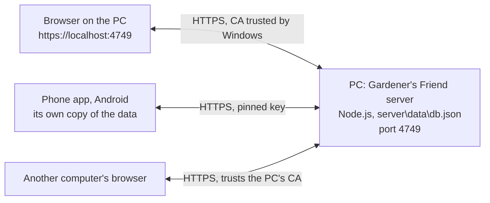

# Phone, PC and sync

Gardener's Friend runs on your PC and on your phone, and keeps them in step over your own Wi-Fi. Nothing goes to the
internet or a cloud service. It works the same way as Field Service Ops.

## Set up (once)

1. **On the PC:** double-click `server\start-gf.bat`. The first time it gets portable Node.js (if the PC doesn't have
   Node 20+) and asks Windows to trust the server's own certificate (choose **Yes**). The app opens in its own window.
   Keep the black server window open while you use the app.
2. **Bring your old data (if you used the app from the file before):** in that old copy, **Settings › Export backup**;
   in the new one, **Settings › Import backup**. (A page opened from a file and the server's page are separate as far as
   the browser is concerned, so the data doesn't move by itself.)
3. **Phone app:** run `server\get-phone-app.bat` once. Then **Settings › Phones and computers** shows a QR code: scan it with
   the phone's camera to download and install the app. (The phone warns about the certificate the first time:
   **Advanced › Proceed**. Android asks to allow installing apps from the browser.)
4. **Pair:** in the phone app, **Settings › Scan the PC's QR code**. The PC shows the request in Settings: check the 4-digit
   code matches, then **Accept**. The phone downloads everything and from then on syncs by itself.

If the phone can't reach the PC: both must be on the same Wi-Fi, and Windows must let the server through its firewall
("Allow" on private networks when it asks, or run `server\open-firewall.bat` as administrator once).

## How sync works

- **Every device has its own full copy**, so the app works with no connection at all: in the garden, in a dead zone,
  with the PC off. Changes wait in an outbox ("3 changes waiting" in the sidebar).
- **Sync** happens a moment after each change, every 30 seconds while the app is open (15 on the PC), and whenever the
  app comes back to the screen. **Settings › Sync now** forces one.
- **The PC is the hub.** A device sends its changes with the copy each one started from; the PC merges them
  (three-way merge, like Field Service Ops) and returns everything that changed since that device last synced.
- **Edits on two devices:** different fields are both kept. The same field changed on both: the newer edit wins (times
  are corrected to the PC's clock) and the other value is listed in **Settings › Changed on two devices**.
- **Deletes** sync too. Deleting on one device while editing on another keeps the edited copy.

## Security

- **HTTPS only.** The PC makes its own certificate authority (10 years) and a server certificate for its names and
  addresses (renewed by itself, and when the PC's addresses change). Plain http on the port only redirects.
- **The phone pins the PC's key** (the security code). The pairing QR code carries it; a typed address shows the code to
  compare. If the key ever changes, the phone stops syncing and says so.
- **Only this PC and paired devices get in.** Pairing gives each device a token; the PC stores only its hash.
  **Settings › Phones and computers › Remove** locks a device out.

## Updates

- **PC:** `server\update-gf.bat` (git pull), then restart `start-gf.bat`.
- **Phone:** when the PC runs a newer version, the phone shows **App update ready**; **Settings › Install and restart**
  takes it from the PC over Wi-Fi. A new APK is only needed when the phone's native part changes; GitHub builds it
  (`phone-latest` release) and `get-phone-app.bat` fetches it.

## Where things are

| | |
|---|---|
| `server/server.js` | The server: HTTPS, pairing, sync, phone updates. Node 20+, no add-on libraries. |
| `server/bundle.js` | Packs the app into one page with a version stamp (phone updates). |
| `server/data/` | `db.json`, `backups/db-YYYY-MM-DD.json` (last 30), `tls/` certificates. Not in git. |
| `app/js/store.js` | This device's copy, the outbox, and applying what the PC sends back. |
| `app/js/sync.js` | Connection, pairing, sync timing, phone updates. |
| `app/js/settings.js` | Settings page. |
| `mobile/` | The Android app (Capacitor) and its HTTPS plugin (`GfTls`, pinned key). See `mobile/README.md`. |
| `.github/workflows/phone-app.yml` | Builds and signs the APK on every change to the app. |
